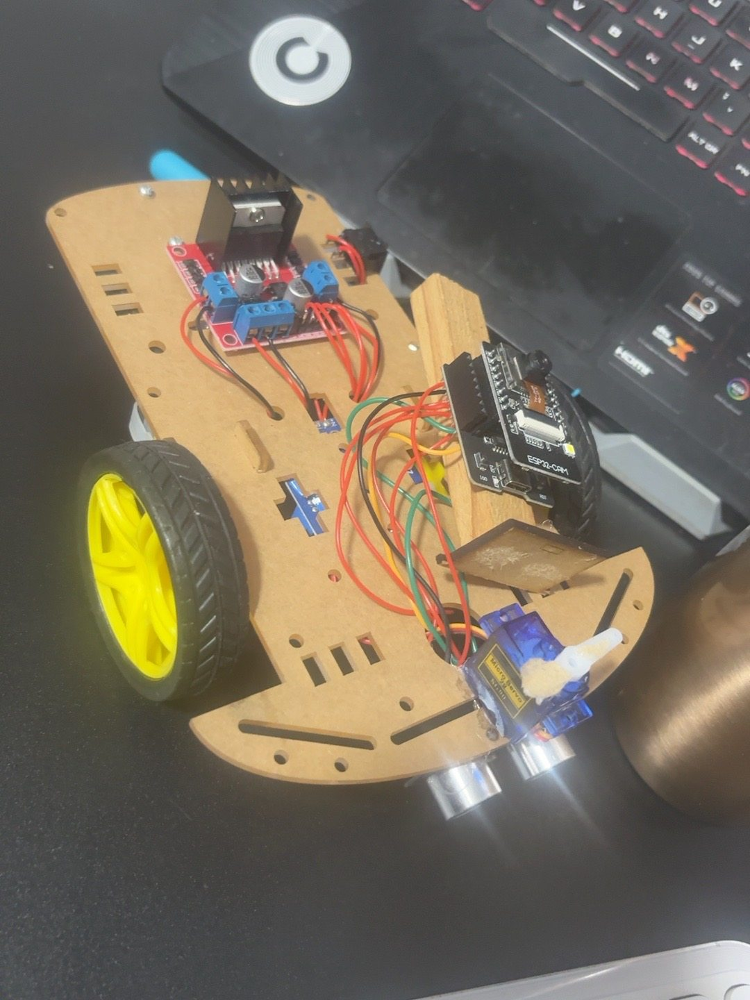
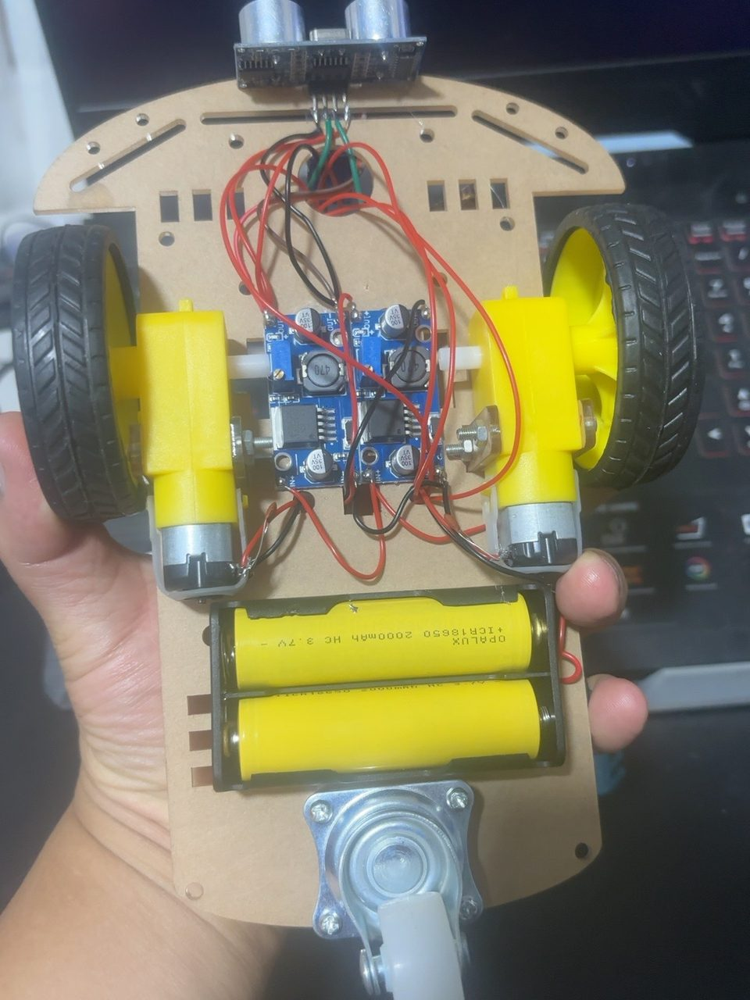

# LLMia · Robot explorador

Prototipo universitario de robótica móvil de la UPN. El firmware base de la ESP32-CAM sirve una interfaz web local para ver la cámara, controlar el robot y consultar la distancia frontal. El proyecto contempla integrar Gemini para describir el entorno a partir de imágenes capturadas por el robot.

## Montaje del prototipo

*Evidencia del montaje físico del 10 de noviembre de 2026.*

| Componente | Función |
| --- | --- |
| ESP32-CAM con módulo de cámara | Captura imágenes y sirve la interfaz web por Wi‑Fi. |
| Controlador de motores tipo L298N | Controla el sentido de giro de los motores de tracción. |
| Sensor ultrasónico frontal | Mide la distancia a obstáculos. |
| Microservo frontal | Permite orientar el elemento montado en su brazo. |

### Vista inferior del chasis

| Componente visible | Función |
| --- | --- |
| Dos motorreductores DC tipo TT | Accionan las ruedas laterales. |
| Rueda giratoria de apoyo | Sostiene el chasis y acompaña los giros. |
| Portapilas con dos celdas cilíndricas | Aloja las celdas que alimentan el prototipo. |
| Dos módulos convertidores DC-DC | Acondicionan la alimentación. Los voltajes de salida y la asignación de cada módulo quedan por verificar en el prototipo. |

## Primera prueba desde el celular

1. Configura la contraseña Wi‑Fi en una copia local del [firmware](firmware/LLMia/LLMia.ino), carga el programa en la ESP32-CAM y abre el monitor serie a 115200 baudios.
2. Conecta el celular a la red Wi‑Fi `Carrito_CAM`. Si el celular avisa que la red no tiene internet, mantén la conexión a esa red.
3. Abre en el navegador la IP indicada en el monitor serie. En la pantalla principal, verifica la vista de cámara. Abre también la ruta `/capture` de esa misma IP para comprobar que devuelve una imagen.
4. Cambia el objeto frente a la cámara y vuelve a cargar `/capture`. La prueba se cumple si la nueva imagen muestra el cambio.

**Estado del avance.** El montaje está documentado con vistas superior e inferior. La prueba desde el celular queda pendiente de ejecución en el prototipo y la integración con Gemini corresponde a una etapa posterior.
