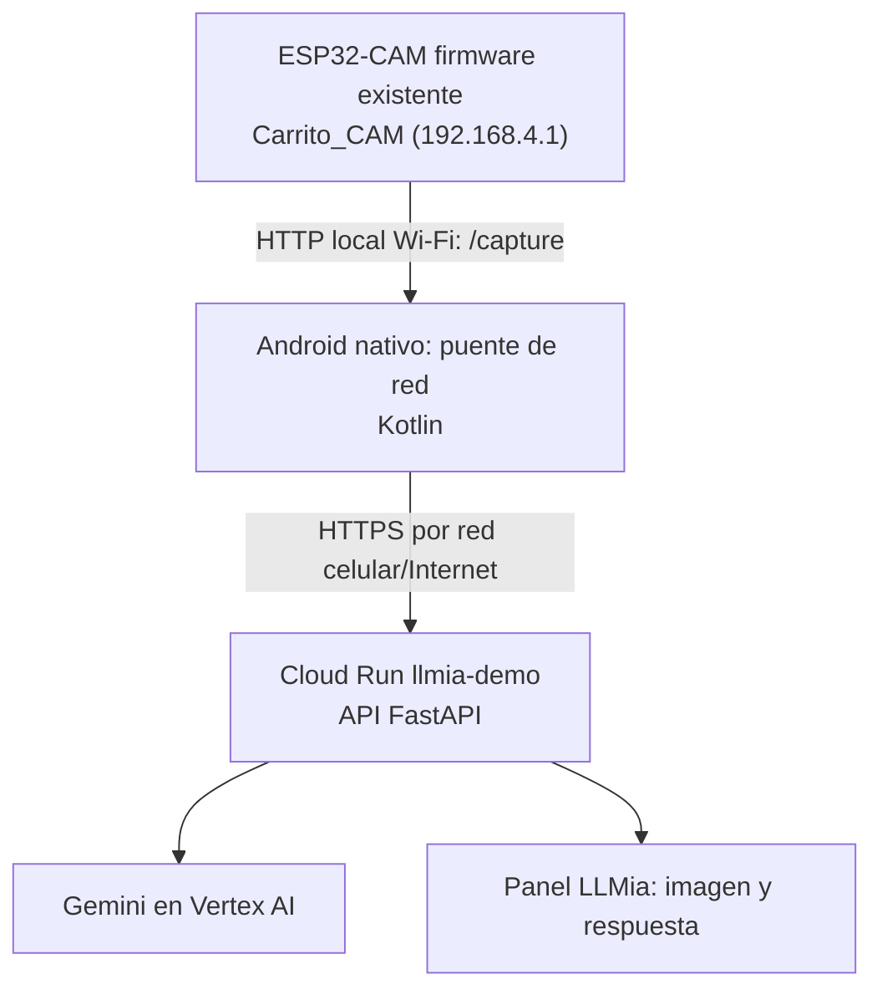

# ADR-02 — Android como puente de LLMia conservando el firmware de la ESP32-CAM

**Estado:** Decisión arquitectónica adoptada por el usuario, 2026-11-15. **Implementación:** pendiente.

## Decisión
Para la siguiente etapa de LLMia se utilizará una **app Android nativa como puente** entre el punto de acceso Wi-Fi del robot `Carrito_CAM` y el backend existente en Cloud Run/Gemini. **No flashear ni sustituir el firmware actualmente instalado en la ESP32-CAM**. El repositorio conserva versiones del firmware preparadas, pero no se presupone que están grabadas en la placa.

## Evidencia del firmware existente
La ESP32-CAM ya permite capturar JPEG desde `GET http://192.168.4.1/capture`, consultar distancia (`/distance`), y ofrece interfaz y mandos locales (`/move`, `/servo`, `/sweep`, `/photos`, `/photo`). Se ha comprobado que la cámara funciona desde el teléfono en la red del robot. No se ha validado todavía la conexión Android→Cloud Run con una imagen física.

## Flujo previsto

La aplicación Android debe verificar simultáneamente el acceso Wi-Fi local (normalmente sin Internet) y a Internet por datos móviles. Usar APIs de red específicas (`ConnectivityManager` / `Network` y sockets vinculados explícitamente) para separar tráfico a `192.168.4.1` del tráfico HTTPS público; **no asumir** que Android utilizará las rutas correctas en todos los fabricantes. No exponer el servidor HTTP local al Internet.

## Seguridad / autentificación
El backend actual usa credencial de dispositivo para `/device/v1/poll` y `/device/v1/observations/{id}/capture`. **No incrustar el token de dispositivo en APK, Gradle, Git ni capturas.** Diseñar y probar un mecanismo de aprovisionamiento/revocación o un flujo de operador autenticado con permisos mínimos antes de distribuir la aplicación; no dar por realizada esta integración.

## Alcance inicial
1. App Android lee una imagen JPEG real del robot y la presenta en pantalla (sin enviar a nube).
2. Validar acceso simultáneo a Wi-Fi del robot y datos móviles / Internet.
3. Incorporar flujo seguro de nube, reutilizando el contrato de observaciones, sin guardar tokens en el repositorio.
4. Enviar una sola captura bajo demanda y visualizar descripción Gemini.
5. Probar objetos concretos, latencia y errores; controlar motores solo en un incremento posterior con pruebas locales de parada.

## Restricciones y pendientes
- El usuario indicó previamente que tiene **iPhone** y no Android disponible; antes de ejecutar debe confirmarse disponibilidad de un teléfono/tablet Android de prueba.
- El firmware que corre en la ESP32-CAM **no ha sido reprogramado** con el cambio AP+STA que quedó versionado. Esta arquitectura solo requiere el modo `Carrito_CAM` existente.
- La captura JPEG y Cloud Run/Gemini fueron probados **por separado**, no de extremo a extremo a través de Android.
- No hacer nuevas escrituras de firmware ni despliegues en producción sin pruebas puntuales y autorización.
- El puente Windows disponible en GitHub queda como alternativa técnica y material de comparación, no como arquitectura escogida.

## Primer criterio de aceptación
En un Android físico, Wi-Fi conectado a `Carrito_CAM`, cámara accesible por `http://192.168.4.1/capture`, y conectividad HTTPS a Cloud Run mediante una ruta de Internet simultánea. Solo después desarrollar el envío autenticado.
