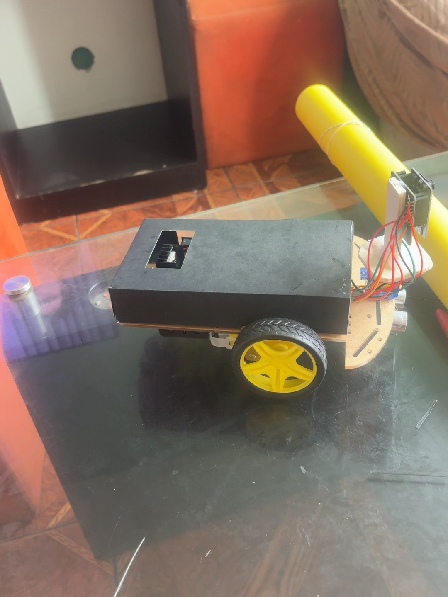
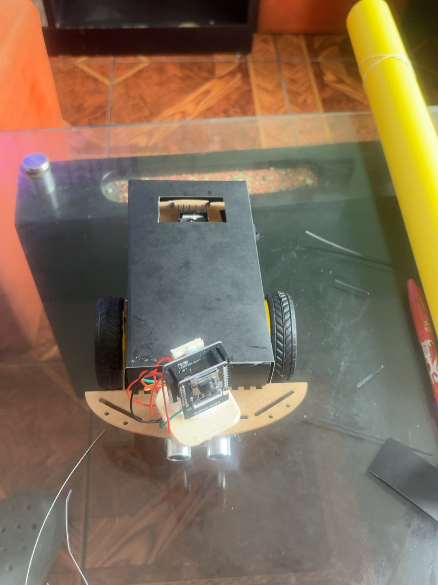

# Carrocería Rover científico — 21 de noviembre de 2026

## Evidencia del montaje

Julius compartió estas dos fotografías del prototipo LLMia con una cubierta negra de cartulina sobre el chasis de madera. Se conserva cada archivo original sin modificación.

### Vista superior y frontal

### Vista lateral

## Estado visible y pendientes

- Cubierta negra instalada; cámara y sensor frontal descubiertos.
- Abertura superior sobre la zona del disipador del controlador de motores.
- Los logos LLMia/UPN y las franjas amarillas están preparados para impresión; **aún no aparecen colocados en estas fotografías**.
- Las fotos documentan el aspecto del montaje. No certifican holguras de ruedas, giro completo de cámara ni comportamiento térmico; esas comprobaciones quedan pendientes después del montaje.

## Punto de control

Este registro añade evidencia física a la demo conservada en el [cierre del 20 de noviembre](PUNTO_DE_CONTROL_2026-11-20_CIERRE_DEMO.md). No modifica firmware, aplicación Android, backend ni despliegues. Las mejoras de software de la fase posterior mantienen su estado anterior.

### Archivos originales

| Archivo en el repositorio | Original recibido |
| --- | --- |
| llmia-carroceria-2026-11-21-superior-frontal.jpg | IMG_5D1FFCB3-B808-453D-BB55-4E4D48569ACC.jpeg |
| llmia-carroceria-2026-11-21-lateral.jpg | IMG_B4FC219F-4210-48E0-8C5D-2E565500D076.jpeg |
