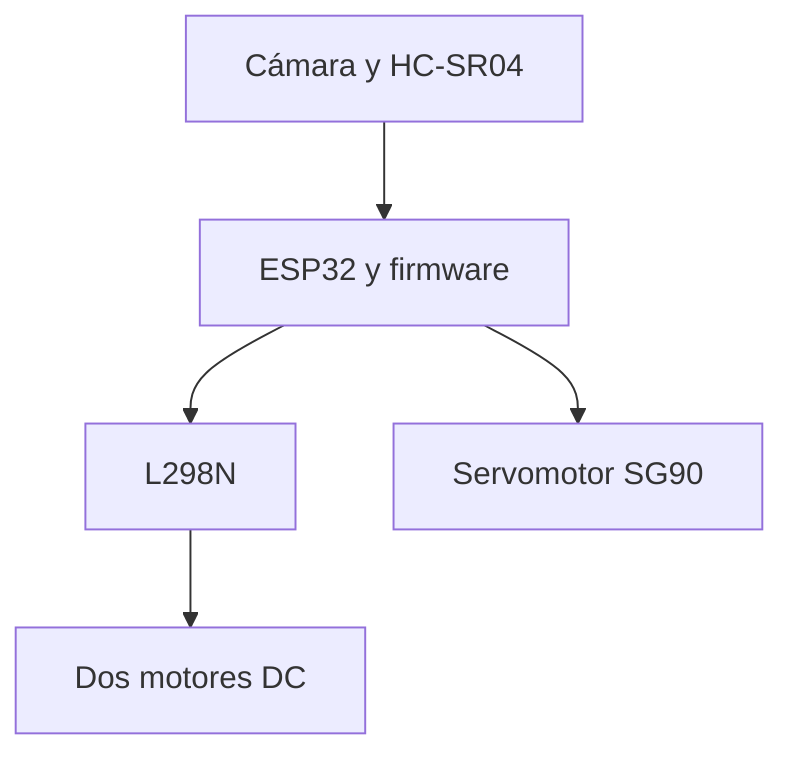
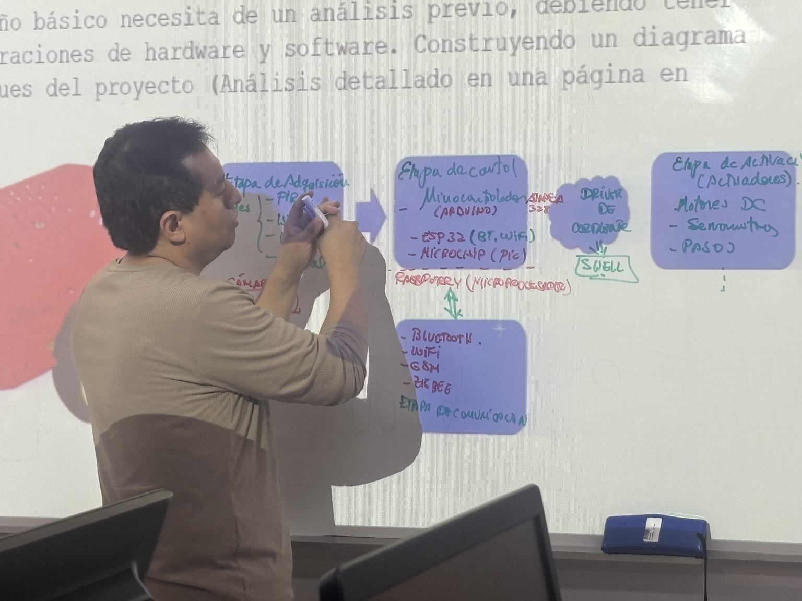
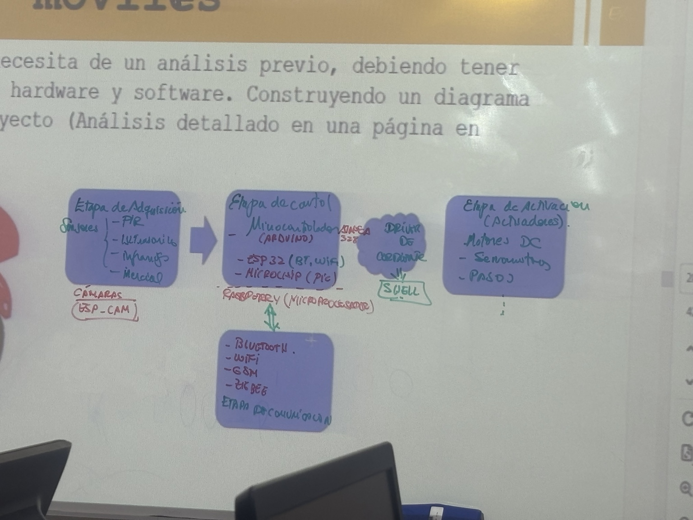
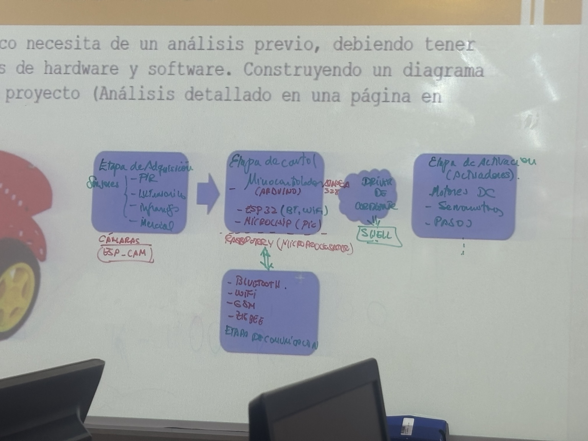

# Clasificación funcional de componentes de LLMia

Registro: 25 de noviembre de 2026. Referencia: fotografías de la explicación del profesor proporcionadas por Julius. Esta clasificación sirve como base para la sección «Diseño del sistema y diagrama de bloques» del informe final.

## Criterio explicado en clase

En las fotografías se distinguen adquisición, control, etapa de potencia entre el controlador y los actuadores, actuación y comunicación. Los ejemplos escritos por el profesor son alternativas tecnológicas; no todos forman parte de LLMia.

## Aplicación a LLMia

| Etapa | Componentes utilizados | Función |
| --- | --- | --- |
| Adquisición | Cámara de la ESP32-CAM y sensor ultrasónico HC-SR04 | Capturar imágenes y medir la distancia frontal. |
| Control | Microcontrolador ESP32 y firmware | Procesar órdenes, consultar sensores y aplicar condiciones de parada. |
| Potencia o accionamiento | Controlador de motores L298N | Recibir señales del ESP32 y suministrar potencia a los motores de tracción. |
| Actuación | Dos motores DC y servomotor SG90 | Mover las ruedas y orientar la cámara. El servo recibe su señal de control directamente del ESP32; no pasa por el L298N. |
| Comunicación | Wi-Fi de la ESP32 y Wi-Fi/datos móviles del teléfono | Conectar Android con el robot y con el backend en la nube. |

La placa ESP32-CAM participa en adquisición, control y comunicación: integra cámara, microcontrolador y Wi-Fi. El L298N es un controlador de potencia; los motores son actuadores.

## Diagrama funcional del robot

El diagrama representa el flujo funcional y de señales; no es un esquema de cableado ni de alimentación.

## Subsistemas complementarios del proyecto

| Subsistema | Componentes | Función |
| --- | --- | --- |
| Interfaz del operador | Aplicación Android | Conducción, visualización de cámara y envío de preguntas. |
| Inteligencia artificial | Backend en Cloud Run y Gemini en Vertex AI | Analizar imágenes y generar descripciones. Gemini no decide movimientos del robot. |
| Autenticación y autorización | Firebase Authentication y lista de UID permitidos del backend | Identificar al operador y comprobar su acceso. |
| Alimentación | Baterías, portapilas y convertidores DC-DC | Alimentar los circuitos y actuadores. Los voltajes deben documentarse con mediciones. |
| Estructura mecánica | Chasis, ruedas motrices, rueda loca y carrocería | Sostener y proteger el conjunto. |

Android se comunica por Wi-Fi con el robot y utiliza la conexión a Internet del teléfono para acceder al backend. La descripción visual se obtiene mediante el backend y se presenta en Android. Las órdenes de movimiento se procesan por la ruta local de control.

## Fotografías de referencia

Las tres fotografías originales se conservan sin edición. Se documenta la explicación técnica sin identificar a las personas de las imágenes.

### IMG_3015

### IMG_3016

### IMG_3017

## Uso en el informe final

Explicar para cada etapa sus entradas, salidas, componentes y relación con las demás. Complementar este análisis con el esquema eléctrico y la evidencia de funcionamiento. Este registro no modifica el archivo Word, código, firmware ni despliegues.
