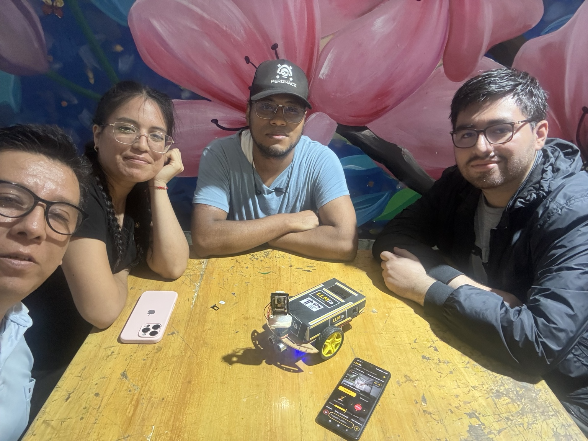
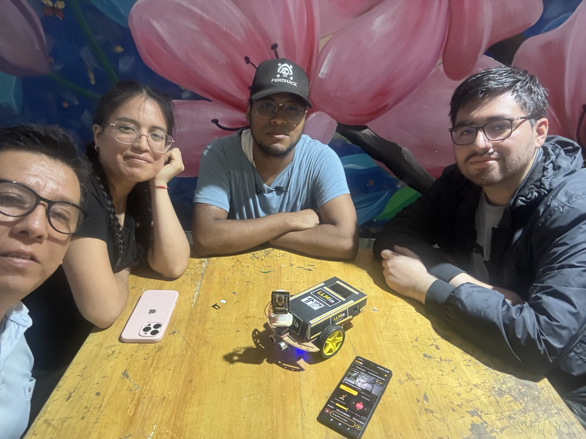
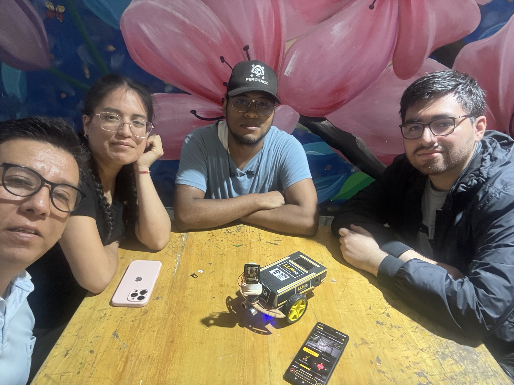
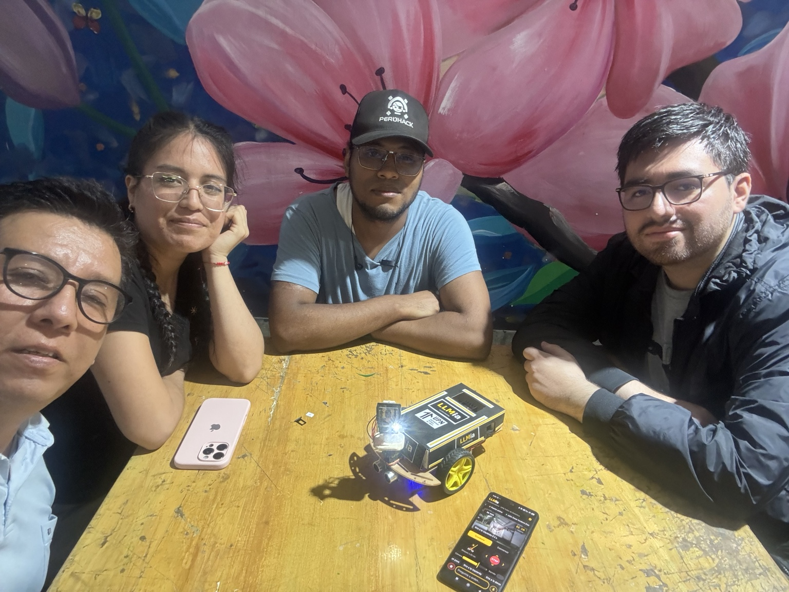
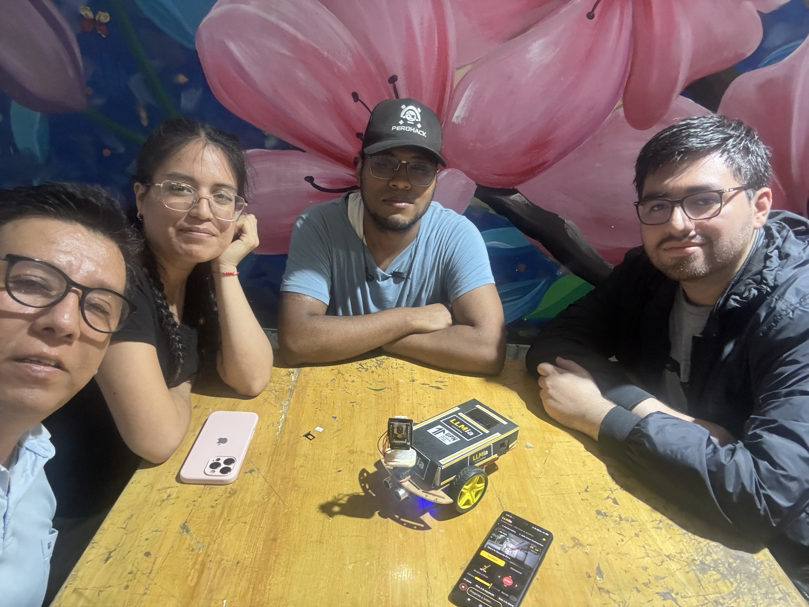

# Evidencia de funcionamiento: LLMia, Android y Gemini en Vertex AI

Fecha de registro: 24 de noviembre de 2026 (Perú). Material proporcionado por Julius durante la demostración con su equipo.

## Demostración física

Las cinco fotografías originales muestran el robot LLMia con carrocería negra, logos LLMia y UPN, franjas amarillas, cámara y sensor frontal, junto al teléfono Android con la interfaz de control y el equipo de trabajo.

El video muestra la aplicación en un teléfono físico, la vista de cámara, controles de conducción, distancia frontal, el indicador de puente activo y una respuesta descriptiva visible en pantalla. Julius reporta el funcionamiento e integración con Gemini mediante Vertex AI. Este material documenta la demostración; no constituye una medición de latencia ni sustituye las pruebas repetidas de seguridad y aceptación.

[Ver o descargar video completo (1 min 45 s)](evidencias/2026-11-24/LLMia_Android_Gemini_demo.mp4)

El video publicado es una copia comprimida de IMG_3018.mp4, con la duración completa y audio, en H.264/AAC para facilitar la consulta. Las fotos se conservan sin edición.

## Videos adicionales — 25 de noviembre de 2026

Julius aporta cinco grabaciones adicionales como evidencia de funcionamiento. Se publican copias comprimidas H.264/AAC con audio y duración completa, sin recortes; los nombres permiten relacionarlas con los originales.

| Original | Duración | Evidencia publicada |
| --- | --- | --- |
| IMG_3024.mp4 | 13,27 s | [Ver o descargar video](evidencias/2026-11-25/IMG_3024_demo.mp4) |
| IMG_3025.mp4 | 73,00 s | [Ver o descargar video](evidencias/2026-11-25/IMG_3025_demo.mp4) |
| IMG_3026.mp4 | 28,30 s | [Ver o descargar video](evidencias/2026-11-25/IMG_3026_demo.mp4) |
| IMG_3027.mp4 | 51,67 s | [Ver o descargar video](evidencias/2026-11-25/IMG_3027_demo.mp4) |
| IMG_3028.mp4 | 99,30 s | [Ver o descargar video](evidencias/2026-11-25/IMG_3028_demo.mp4) |

Estas grabaciones se agregan al registro de la demostración. No se asignan resultados cuantitativos de aceptación ni se dan por cerrados ensayos de seguridad a partir de esta incorporación.

## Galería

### IMG_3019

### IMG_3020

### IMG_3021

### IMG_3022

### IMG_3023

## Punto de control

- Evidencia física incorporada: cinco fotografías y seis videos de la demostración (incluidos los cinco añadidos el 25 de noviembre).
- Integración Android y Gemini/Vertex AI: funcionamiento reportado por el operador, con interacción y descripción visibles en el video.
- Cloud Run: el operador compartió la salida de actualización de la lista de acceso, revisión `llmia-demo-00006-qpv`, con 100 % de tráfico. No se verificó aquí el digest de imagen desplegado.
- Pendiente de registrar por separado: ensayos repetidos de bloqueo ante obstáculos, parada por pérdida de conexión, precisión en cinco escenas y reconocimiento de órdenes.
- Este registro actualiza documentación y medios. No cambia código, firmware ni despliegues, y no da por aceptadas las mejoras 0.4.
