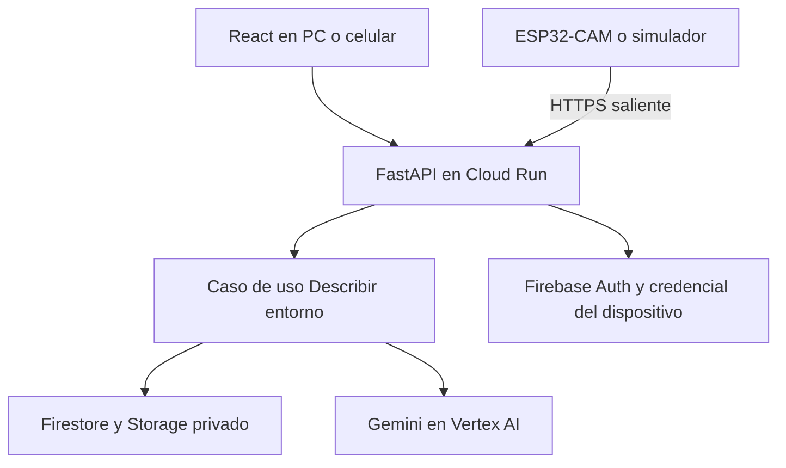

# LLMia | Especificación FAST DEMO

**Estado:** propuesta de implementación. **Versión:** 0.1. **Método:** PA-SDD con un corte vertical y arquitectura hexagonal mínima.

## 1. Propósito y alcance

Un estudiante abre un enlace desde un celular o una PC, inicia sesión y pregunta «¿Qué ves?». LLMia toma una foto nueva con la ESP32-CAM y el panel muestra esa misma imagen junto con una descripción breve en español. La demo funciona sin laptop intermediaria y con el robot detenido.

**Actores:** operador UPN autorizado y dispositivo LLMia registrado. Un robot por demo. El operador supervisa el prototipo en el lugar.

**Base disponible:** [firmware ESP32-CAM](../firmware/LLMia/LLMia.ino), [montaje físico](../README.md#montaje-del-prototipo), panel local, captura JPEG por `/capture` y distancia por `/distance`. El firmware actual crea `Carrito_CAM`; su cliente de nube, el panel React, la integración con Gemini y las pruebas de aceptación están pendientes.

**Incluye:** enlace HTTPS, React adaptable, Firebase Auth, foto bajo demanda, descripción visual y una orden de voz con alternativa por texto. El panel muestra estados de robot y de la solicitud por separado.

**Fuera de alcance:** movimiento desde la nube, movimiento por voz, navegación autónoma, video continuo, reconocimiento de personas, ADK/multiagente, historial de imágenes y aplicación nativa. El firmware local existente conserva sus controles; la parada durante el avance sigue siendo una prueba aparte y no se da por aprobada.

## 2. Historias y aceptación

| ID | Historia | Aceptación observable |
| --- | --- | --- |
| US-01 | Como operador, quiero entrar desde PC o celular y ver si LLMia está conectado. | AC-01: inicio de sesión y panel legible en ambos tamaños. Sin token válido la API responde 401; con usuario sin permiso para el robot responde 403. Sin señal reciente, se muestra «Robot sin conexión». |
| US-02 | Como operador, quiero pedir «¿Qué ves?» por texto y recibir la escena actual. | AC-02: la petición toma una foto nueva y devuelve la imagen asociada al mismo ID que la descripción. En al menos 4 de 5 escenas preparadas, identifica el objeto principal en español. |
| US-03 | Como operador, quiero pedir la descripción por voz y poder seguir si falla el micrófono. | AC-03: al pulsar para hablar, muestra la transcripción y reconoce «¿Qué ves?» o una frase equivalente en al menos 4 de 5 intentos preparados. Una frase ambigua no solicita captura; si se deniega el permiso, el campo de texto sigue disponible. |
| US-04 | Como operador, quiero saber si falla la cámara, la conexión o Gemini. | AC-04: el panel indica la causa, ofrece reintentar con una nueva solicitud y no presenta una foto anterior como actual. Una solicitud vencida o repetida no produce un segundo resultado. |

**Límites de la demo:** una solicitud de captura activa por robot, plazo inicial de 30 s de extremo a extremo como criterio de prueba ajustable tras medir la red del aula. La API termina con un resultado o un error claro; nunca deja el panel esperando indefinidamente. La voz se valida por separado de la exactitud visual.

## 3. Decisión de arquitectura

**ADR-01: un solo corte vertical con puertos y adaptadores.** DevPattern prefiere un corte simple para FAST DEMO. Se elige hexagonal aquí para probar la lógica con robot simulado y cambiar a hardware real sin reescribir el caso de uso. Firebase, Firestore y Gemini quedan fuera del núcleo. Un solo servicio Cloud Run sirve el panel React compilado y la API FastAPI en el mismo origen HTTPS. La ESP32-CAM se conecta en modo cliente a una red con Internet e inicia conexiones HTTPS salientes. La nube no se conecta a la IP privada del robot.

Las flechas hacia servicios indican llamadas; en código, los adaptadores implementan interfaces definidas por la aplicación. React y firmware son clientes externos de la API, no dependencias del dominio.

| Capa | Responsabilidad |
| --- | --- |
| Dominio | Estado y vencimiento de la solicitud, asociación de la imagen con su descripción y único resultado aceptado. Sin dependencias de FastAPI ni SDK de nube. |
| Aplicación | Solicitar y consultar descripción, reclamar captura, recibir JPEG y generar resultado. Puertos de salida: repositorio de solicitudes, almacén de imágenes y descripción visual. |
| Adaptadores de entrada | HTTP de operador, HTTP del robot, verificación de Firebase y credencial exclusiva por dispositivo. El simulador usa el mismo contrato HTTP que la placa. |
| Adaptadores de salida | Firestore para solicitudes y actividad del dispositivo; Cloud Storage privado para JPEG temporales; Gemini para descripción. Speech-to-Text en la fase de voz, detrás de un puerto de transcripción. |

## 4. Contrato inicial

| Actor | Ruta | Resultado |
| --- | --- | --- |
| Operador | `GET /api/v1/robots/{robot_id}/status` | Estado en línea o fuera de línea, última señal y estado de solicitud. |
| Operador | `POST /api/v1/robots/{robot_id}/observations` | Crea solicitud, responde 202 con ID y vencimiento. Si hay otra activa, responde 409. |
| Operador | `GET /api/v1/observations/{id}` | Devuelve estado y, si está lista, descripción y referencia a una ruta autenticada para el JPEG. |
| Operador | `GET /api/v1/observations/{id}/image` | Entrega el JPEG asociado solo al operador autorizado para esa solicitud. |
| Operador | `POST /api/v1/voice/interpret` | Recibe audio breve; devuelve transcripción e intención `DESCRIBIR` o `NO_ENTENDIDO`. No activa motores. |
| Dispositivo | `POST /device/v1/poll` | Registra actividad y reclama una captura vigente asignada al robot. Devuelve un ID de solicitud o 204 si no hay trabajo. |
| Dispositivo | `PUT /device/v1/observations/{id}/capture` | Recibe un JPEG del dispositivo asignado. Una repetición no inicia otra inferencia ni sobrescribe el resultado. |

**Estados:** `PENDIENTE → RECLAMADA → ANALIZANDO → LISTA`; estados terminales alternativos: `ERROR` y `VENCIDA`. Guardar ID, robot, operador, fechas, estado y referencia privada al JPEG. Verificar el vencimiento antes de reclamar, subir o publicar el resultado. Las transiciones que evitan reclamos o procesamientos duplicados usan una operación atómica en Firestore. Si una instancia cae durante el análisis, la solicitud vence y el operador inicia otra. La inferencia no ocurre dentro de la transacción.

**Reglas:** Firebase valida identidad de la persona y FastAPI verifica su permiso sobre el robot. El dispositivo usa una credencial separada, revocable y ligada a su ID. El JPEG tiene límites de tamaño, formato y retención; el audio se transcribe bajo demanda y no se conserva. Sin claves en Git o React y sin acceso directo del navegador al almacén de imágenes. Gemini devuelve texto, sin herramientas para accionar motores.

## 5. Plan por cortes y evidencias

| Orden | Incremento | Evidencia para avanzar |
| --- | --- | --- |
| 1 | Núcleo FastAPI y adaptadores de prueba; simulador con dos JPEG de escena conocida. | Pruebas de estados, autorización, reclamo duplicado, vencimiento y foto asociada a su resultado. |
| 2 | React adaptable, Firebase Auth y despliegue en Cloud Run con el simulador. | Enlace HTTPS, acceso válido y pruebas 401/403. Demo desde PC y celular. |
| 3 | Adaptador Gemini y conexión HTTPS saliente de la placa, reutilizando la captura existente. | Dos fotos consecutivas de objetos distintos desde el robot real y resultados de 5 escenas. |
| 4 | Pulsar para hablar, transcripción e interpretación de la orden de descripción. | 5 instrucciones grabadas, caso ambiguo y prueba con micrófono denegado; texto como alternativa. |

**Registro por prueba:** ID de aceptación, commit, fecha, entorno, esperado, observado y enlace a captura o video. Marcar por separado simulador y hardware real. La demo se considera aprobada solo con evidencia de AC-01 a AC-04 sobre el entorno desplegado y con la placa real en el flujo de cámara.

**Regla para ampliar el alcance:** probar primero la parada local si aparece un obstáculo después de iniciar la marcha y la pérdida del enlace, incluso sin Internet. Ninguna futura orden de voz ni STOP de la web reemplazará esa protección local.

## Referencias

- [DevPattern: PA-SDD](https://github.com/JuliusCordova/DevPattern/blob/main/patterns/progressive-agentic-sdd/README.md)
- [DevPattern: especificación mínima](https://github.com/JuliusCordova/DevPattern/blob/main/definition-packs/minimum-sufficient-specification.md)
- [DevPattern: arquitectura](https://github.com/JuliusCordova/DevPattern/blob/main/patterns/architecture/README.md)
- [Firebase: verificación de tokens](https://firebase.google.com/docs/auth/admin/verify-id-tokens) y [Firestore: transacciones](https://firebase.google.com/docs/firestore/manage-data/transactions)
